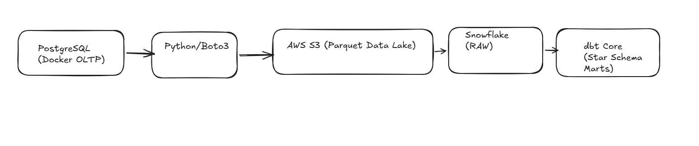
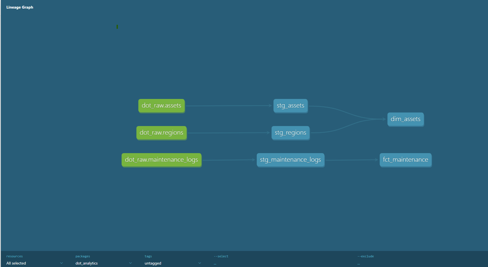

# DOT Infrastructure & Maintenance Cloud Data Warehouse

An end-to-end data engineering pipeline simulating the modernization of a legacy relational transactional database (**PostgreSQL OLTP**) into a scalable cloud data warehouse (**AWS S3 + Snowflake + dbt Core**).

## Architecture Overview

1. **Source OLTP Database (PostgreSQL & Docker):** Simulates an operational Department of Transportation (DOT) system tracking regional infrastructure assets and 5,000+ maintenance work logs.
2. **Cloud Ingestion Layer (Python & AWS S3):** Extracts relational tables using `psycopg2` and `pandas`, serializes them into columnar **Parquet** format (`pyarrow`), and loads them into a structured **AWS S3 Data Lake** via `boto3`.
3. **Cloud Data Warehouse (Snowflake):** Uses an external S3 `STAGE` and `COPY INTO` commands to ingest raw Parquet files into `DOT_DW.RAW`.
4. **Analytics Engineering & Transformation (dbt Core):** Implements a modular multi-layer transformation pipeline (`Staging` ➔ `Star Schema Marts`) with automated data quality testing.

## Data Modeling & Engineering Highlights

* **Dimensional Modeling (Star Schema):** Transformed normalized operational tables into analytics-ready fact and dimension tables (`dim_assets` and `fct_maintenance`).
* **Incremental Materialization:** Configured `fct_maintenance` using `dbt` incremental logic (`is_incremental()`) to process only newly arrived maintenance logs—mirroring enterprise **Oracle Materialized View Fast Refresh** patterns to minimize compute costs.
* **Automated Data Quality Gatekeeping:** Enforced primary key uniqueness (`unique`), completeness (`not_null`), and referential integrity (`relationships`) across mart models via `dbt test`.

## Tech Stack
* **Databases & Warehousing:** PostgreSQL 15, Snowflake
* **Transformation & Modeling:** dbt Core (`dbt-snowflake`), SQL
* **Cloud & Containerization:** AWS S3, IAM, Docker, Docker Compose
* **Languages & Libraries:** Python (`pandas`, `boto3`, `psycopg2`, `pyarrow`, `Faker`)

## How to Run Locally
1. Start the local PostgreSQL container: `docker compose up -d`
2. Seed the operational database: `python data_generator/seed_postgres.py`
3. Extract tables to AWS S3 as Parquet: `python ingestion/extract_to_s3.py`
4. Load S3 stage into Snowflake `RAW` tables and execute `dbt run` and `dbt test`.
